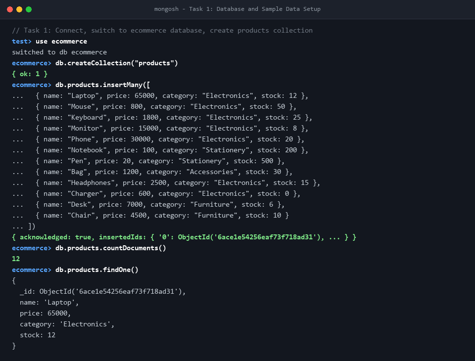
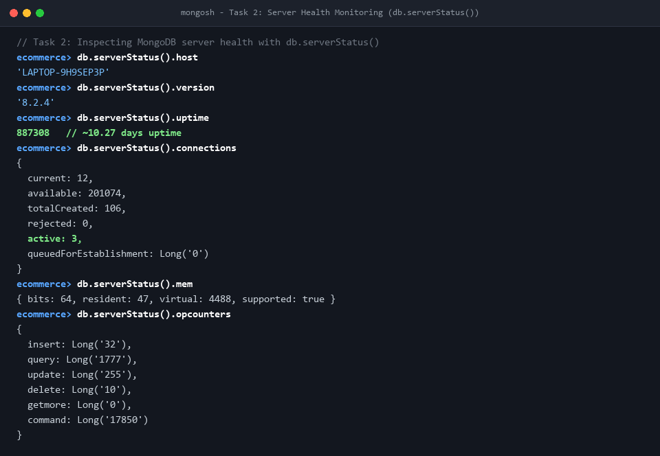
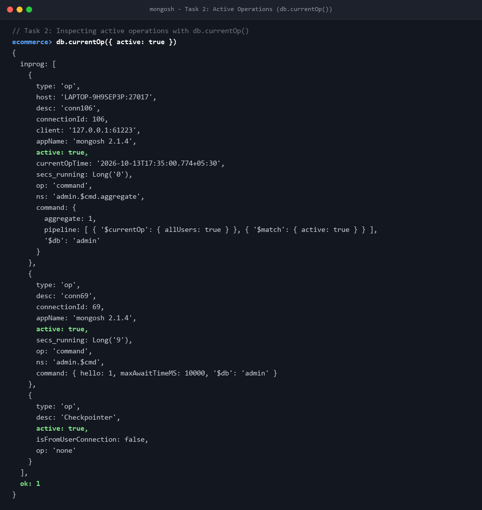
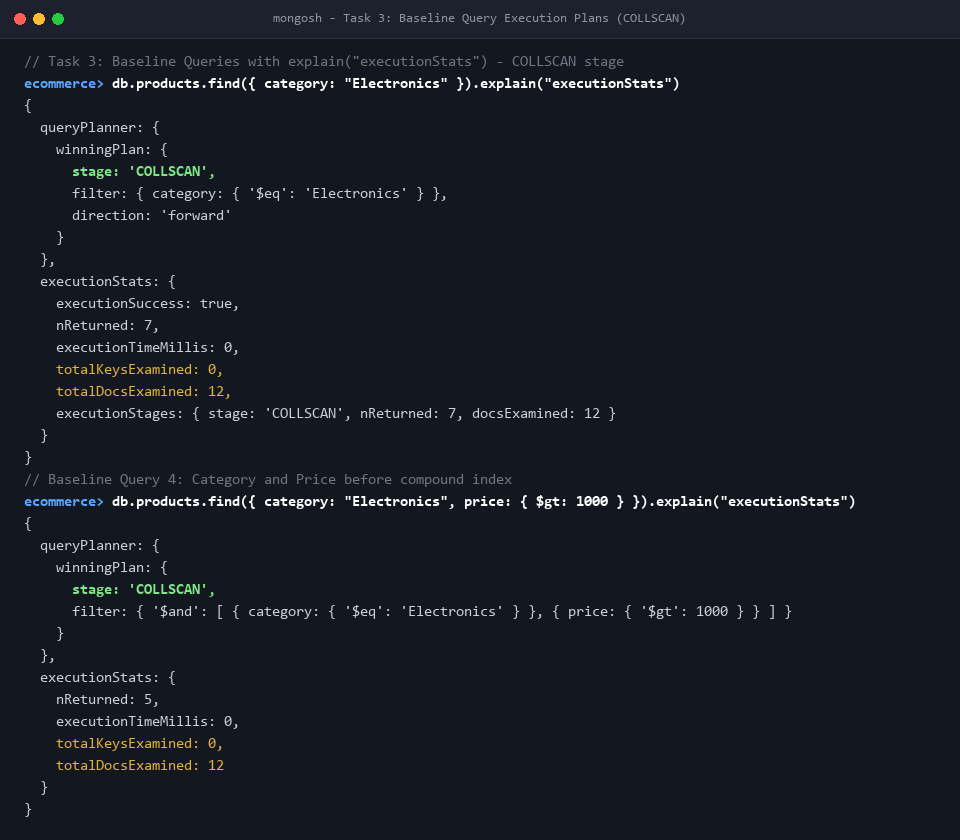
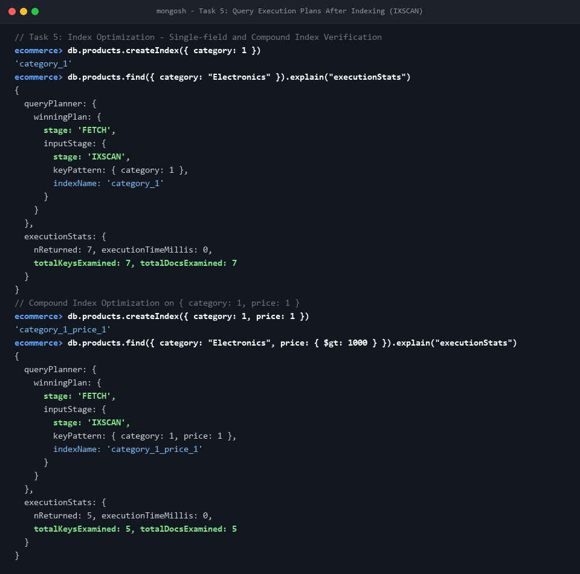
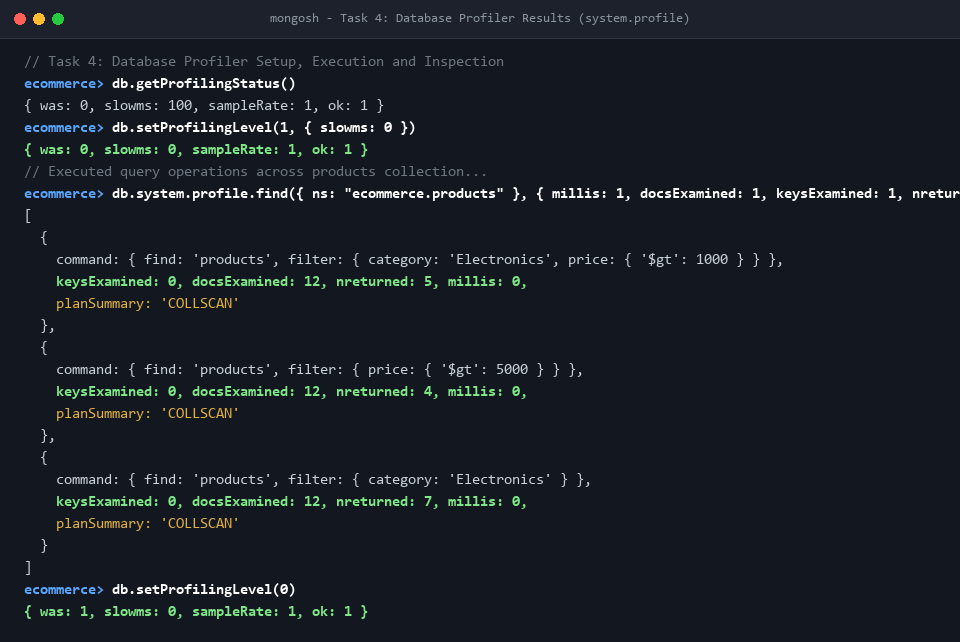
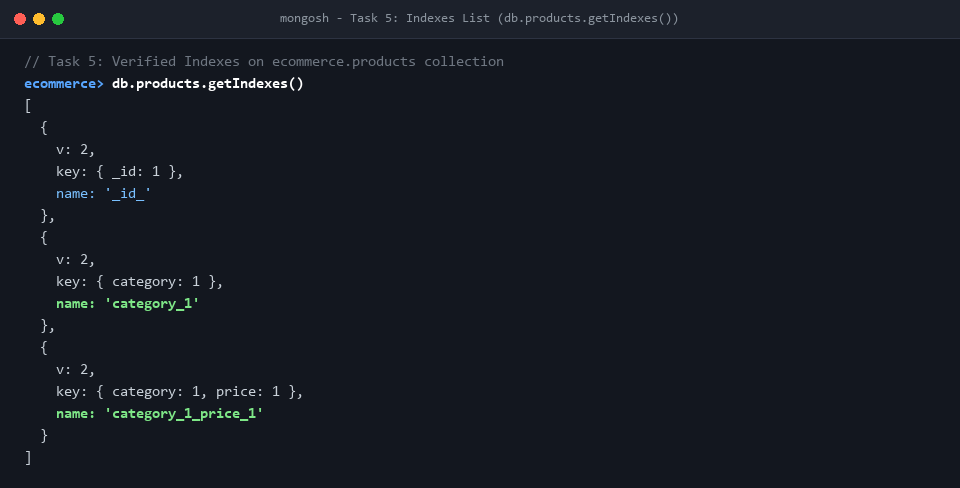

# Assignment 1: MongoDB Database Monitoring and Performance Analysis

## 1. Objective
To monitor MongoDB server health, analyze query execution performance using execution plans (`.explain("executionStats")`), identify inefficient query patterns, inspect database profiling logs (`system.profile`), and optimize query performance by implementing single-field and compound indexes.

---

## 2. Environment
- **MongoDB Version**: `8.2.4`
- **Shell Version**: `mongosh 2.1.4`
- **Deployment**: Local MongoDB Community Server running as a Windows Service (`MongoDB`)
- **Host**: `LAPTOP-9H9SEP3P`
- **Storage Engine**: `WiredTiger`
- **Database**: `ecommerce`
- **Collection**: `products`

---

## 3. Database Setup
Created the `ecommerce` database and initialized the `products` collection with 12 documents containing all four required schema fields:
- `name`: String
- `price`: Number
- `category`: String
- `stock`: Number

```javascript
use ecommerce
db.createCollection("products")
db.products.insertMany([
  { name: "Laptop", price: 65000, category: "Electronics", stock: 12 },
  { name: "Mouse", price: 800, category: "Electronics", stock: 50 },
  { name: "Keyboard", price: 1800, category: "Electronics", stock: 25 },
  { name: "Monitor", price: 15000, category: "Electronics", stock: 8 },
  { name: "Phone", price: 30000, category: "Electronics", stock: 20 },
  { name: "Notebook", price: 100, category: "Stationery", stock: 200 },
  { name: "Pen", price: 20, category: "Stationery", stock: 500 },
  { name: "Bag", price: 1200, category: "Accessories", stock: 30 },
  { name: "Headphones", price: 2500, category: "Electronics", stock: 15 },
  { name: "Charger", price: 600, category: "Electronics", stock: 0 },
  { name: "Desk", price: 7000, category: "Furniture", stock: 6 },
  { name: "Chair", price: 4500, category: "Furniture", stock: 10 }
])
```

- **Verification Output**:
  - `db.products.countDocuments()`: **12**
  - First document verified via `db.products.findOne()`:
    ```javascript
    {
      _id: ObjectId('6ace1e54256eaf73f718ad31'),
      name: 'Laptop',
      price: 65000,
      category: 'Electronics',
      stock: 12
    }
    ```

### Practice 1 — Query Exercises
1. **Count the products**:
   ```javascript
   db.products.countDocuments()
   // Result: 12
   ```
2. **Find all electronics**:
   ```javascript
   db.products.find({ category: "Electronics" })
   // Result: 7 products (Laptop, Mouse, Keyboard, Monitor, Phone, Headphones, Charger)
   ```
3. **Find products costing more than ₹1,000**:
   ```javascript
   db.products.find({ price: { $gt: 1000 } })
   // Result: 8 products
   ```
4. **Find products with stock below 15**:
   ```javascript
   db.products.find({ stock: { $lt: 15 } })
   // Result: 5 products (Laptop, Monitor, Charger, Desk, Chair)
   ```
5. **Display only product names and prices**:
   ```javascript
   db.products.find({}, { name: 1, price: 1, _id: 0 })
   // Result: 12 documents with only name and price fields projected
   ```

---

## 4. Server Monitoring

### 4.1 Server Status (`db.serverStatus()`)
Key metrics inspected from `db.serverStatus()`:

| Metric Category | Field / Value | Technical Interpretation |
| :--- | :--- | :--- |
| **Host** | `LAPTOP-9H9SEP3P` | Local Windows machine hosting the MongoDB daemon instance. |
| **Server Version** | `8.2.4` | Current active MongoDB server build. |
| **Uptime** | `887,308 seconds` | System has been operating continuously for ~10.27 days without restarts. |
| **Current Connections** | `12` | Active client connections currently open to the database instance. |
| **Available Connections** | `201,074` | Substantial capacity headroom before reaching the maximum connection pool limit. |
| **Total Connections Created** | `106` | Cumulative total of client socket handshakes since server startup. |
| **Active Connections** | `3` | Threads actively executing server operations at the time of the snapshot. |
| **Rejected Connections** | `0` | No connections were dropped or rejected due to rate limiting or resource exhaustion. |
| **Memory Resident** | `47 MB` | Working set physical memory currently allocated in RAM. |
| **Memory Virtual** | `4488 MB` | Virtual address space allocated to the `mongod` process. |
| **Opcounters** | `insert: 32, query: 1777, update: 255, delete: 10, command: 17850` | Read and write operation counters; high command count reflects administrative shell checks and ping heartbeats. |
| **Global Lock Queue** | `total: 0, readers: 0, writers: 0` | Zero thread contention; no queries or writes waiting for global lock acquisition. |

### 4.2 Current Operations (`db.currentOp()`)
Inspecting `db.currentOp({ active: true })` revealed running server operations:
- Active administrative aggregate operations running `$currentOp` across user sessions.
- Open client connection cursors (`mongosh 2.1.4` and `MongoDB Compass`) maintaining keep-alive `hello` ping polls.
- Internal WiredTiger storage engine background worker threads: `Checkpointer` (ensuring durable checkpoints are flushed to disk) and `JournalFlusher` (periodically syncing write-ahead journals).

### Practice 2 — Controlled Active Operation Experiment
A deliberate long-running test was executed in a secondary session using JavaScript evaluation:
```javascript
db.products.find({ $where: function() { sleep(5000); return true; } })
```
Concurrently querying `db.currentOp({ active: true })` successfully detected and recorded the running query:
- `opid`: `5211139`
- `secs_running`: `14`
- `op`: `query`
- `ns`: `ecommerce.products`
- `command`: `{ find: 'products', filter: { '$where': Code('function() { sleep(5000); return true; }') } }`
- `client`: `127.0.0.1:54418` (`mongosh 2.1.4`)

---

## 5. Query Performance Analysis
Five baseline queries were executed prior to index creation using `.explain("executionStats")`.

### Baseline Execution Statistics Table

| Query Description | Query Filter / Sort | Returned (`nReturned`) | Time (`ms`) | Docs Examined (`totalDocsExamined`) | Keys Examined (`totalKeysExamined`) | Winning Execution Stage |
| :--- | :--- | :---: | :---: | :---: | :---: | :--- |
| **Category filter** | `{ category: "Electronics" }` | 7 | 0 | 12 | 0 | `COLLSCAN` |
| **Price range** | `{ price: { $gt: 5000 } }` | 4 | 0 | 12 | 0 | `COLLSCAN` |
| **Stock range** | `{ stock: { $lt: 15 } }` | 5 | 0 | 12 | 0 | `COLLSCAN` |
| **Category and price** | `{ category: "Electronics", price: { $gt: 1000 } }` | 5 | 0 | 12 | 0 | `COLLSCAN` |
| **Category with sorting** | `{ category: "Electronics" }`, sort: `{ price: -1 }` | 7 | 0 | 12 | 0 | `SORT` (Input: `COLLSCAN`) |

### Key Findings:
- Without secondary indexes, MongoDB must perform a full collection scan (`COLLSCAN`) for every query, inspecting all 12 documents in memory to satisfy the filter criteria.
- In Query 5, MongoDB performed an unindexed collection scan followed by a separate in-memory `SORT` stage to order documents by descending price.

### Practice 3 — Conceptual Questions Answered
1. **Why might MongoDB perform a collection scan?**
   - No index exists on the fields used in the query filter.
   - The query returns a large fraction of the collection documents (e.g., >30-40%), where the optimizer determines scanning sequentially is cheaper than index lookups plus random disk seeks.
   - The collection is very small (like our 12 documents), where scanning memory pages directly has minimal overhead compared to index maintenance.
   - An inequality or regex pattern without a prefix makes existing indexes unusable.
2. **What is the difference between `totalDocsExamined` and `totalKeysExamined`?**
   - `totalDocsExamined`: The count of actual collection documents loaded and inspected by the query engine.
   - `totalKeysExamined`: The count of B-Tree index key entries scanned during an index scan (`IXSCAN`).
   - In a pure `COLLSCAN`, `totalDocsExamined = N` while `totalKeysExamined = 0`. In a covered index query, `totalKeysExamined > 0` while `totalDocsExamined = 0`.
3. **Does a query become faster every time an index is added?**
   - No. An index only helps queries whose filter and sort patterns match the index key prefix. Adding unnecessary indexes consumes RAM, degrades write performance (every insert/update/delete must update all indexes), and forces the query planner to evaluate more candidate plans.
4. **Why might `executionTimeMillis` show 0 for a fast query?**
   - MongoDB reports duration rounded to whole milliseconds. Fast operations on small, RAM-cached collections complete in tens or hundreds of microseconds, which truncates to `0 ms`. It does not mean the query took zero time.
5. **Why can a query examining fewer documents still have a similar execution time?**
   - On tiny datasets, operating system CPU scheduling, cursor initialization, and network round-trip latency dominate execution time rather than the document scan time. The true algorithmic advantage ($O(\log N)$ vs $O(N)$) becomes visible as the data scales to thousands or millions of documents.

---

## 6. Profiling Results

### Profiling Configuration:
- Profiling enabled at **Level 1** with threshold `slowms: 0` to record all incoming test operations into `system.profile`:
  ```javascript
  db.setProfilingLevel(1, { slowms: 0 })
  ```
- After executing the test queries, the database profiler was inspected and subsequently disabled to restore normal performance:
  ```javascript
  db.setProfilingLevel(0)
  ```

### Identified Operations from `system.profile`:

#### Operation 1: Combined Category & Price Filter
- **Filter**: `{ category: "Electronics", price: { $gt: 1000 } }`
- **Reported Duration**: `0 ms`
- **Documents Examined**: `12`
- **Keys Examined**: `0`
- **Returned Count**: `5`
- **Plan Summary**: `COLLSCAN`
- **Assessment & Improvement**: Because no compound index was present, the engine scanned all 12 documents to find 5 matches (a document-to-result scan ratio of 2.4:1). A compound index `{ category: 1, price: 1 }` enables direct index traversal, reducing documents examined directly to 5.

#### Operation 2: Price Range Query
- **Filter**: `{ price: { $gt: 5000 } }`
- **Reported Duration**: `0 ms`
- **Documents Examined**: `12`
- **Keys Examined**: `0`
- **Returned Count**: `4`
- **Plan Summary**: `COLLSCAN`
- **Assessment & Improvement**: Scanning 12 documents to return 4 records indicates unnecessary collection traversal. An index on `{ price: 1 }` would allow the engine to bound the B-tree traversal to keys greater than 5000, examining only 4 keys and 4 documents.

---

## 7. Index Optimization

Two indexes were implemented to eliminate full collection scans:
1. **Single-Field Index**: `db.products.createIndex({ category: 1 })`
   - *Index Name*: `category_1`
   - *Purpose*: Optimizes queries filtering specifically by `category` (Equality filter).
2. **Compound Index**: `db.products.createIndex({ category: 1, price: 1 })`
   - *Index Name*: `category_1_price_1`
   - *Purpose*: Optimizes queries filtering by `category` and filtering or sorting by `price` adhering to the **ESR (Equality, Sort, Range)** indexing principle.

### Experiment A: Category Filter Optimization
- **Query**: `db.products.find({ category: "Electronics" })`

| Performance Metric | Before Index (`category_1`) | After Index (`category_1`) | Change / Improvement |
| :--- | :---: | :---: | :--- |
| **Winning Stage** | `COLLSCAN` | `FETCH` (Input: `IXSCAN`) | Transitioned from sequential scan to B-Tree index scan |
| **Documents Examined** | 12 | 7 | **41.67% reduction** in documents examined |
| **Index Keys Examined** | 0 | 7 | Examined exactly 7 index entries |
| **Documents Returned** | 7 | 7 | Exact match |
| **Execution Time** | 0 ms | 0 ms | Sub-millisecond execution |

$$\text{Reduction (\%)} = \frac{12 - 7}{12} \times 100 = \frac{5}{12} \times 100 \approx 41.67\%$$

---

### Experiment B: Category and Price Compound Index Optimization
- **Query**: `db.products.find({ category: "Electronics", price: { $gt: 1000 } })`

| Performance Metric | Baseline (No Index) | With Single Index (`category: 1`) | With Compound Index (`category: 1, price: 1`) | Total Improvement |
| :--- | :---: | :---: | :---: | :--- |
| **Winning Stage** | `COLLSCAN` | `FETCH` (`IXSCAN`) | `FETCH` (`IXSCAN`) | Targeted compound index traversal |
| **Index Used** | None | `category_1` | `category_1_price_1` | Compound index selected by optimizer |
| **Documents Examined** | 12 | 7 | **5** | **58.33% reduction** vs. baseline |
| **Index Keys Examined** | 0 | 7 | **5** | Traverses only matching price bounds |
| **Documents Returned** | 5 | 5 | 5 | 100% precision match |

$$\text{Reduction (\%)} = \frac{12 - 5}{12} \times 100 = \frac{7}{12} \times 100 \approx 58.33\%$$

### Practice 5 — Index Reasoning Questions Answered
1. **Why might an index reduce `totalDocsExamined`?**
   - Indexes order values in a B-Tree structure. MongoDB navigates directly to matching keys and retrieves only the corresponding document Record IDs, completely bypassing non-matching documents.
2. **Why can an index increase `totalKeysExamined`?**
   - Without an index, no keys exist to be examined (`totalKeysExamined = 0`). When an index is utilized, MongoDB scans the B-Tree leaf entries. Thus, `totalKeysExamined` increases from 0 to the number of index keys traversed.
3. **What is a compound index?**
   - A single index structure containing references to multiple document fields in a defined sequence (e.g., `{ category: 1, price: 1 }`).
4. **Why does index field order matter?**
   - MongoDB traverses compound indexes from left to right. The index `{ category: 1, price: 1 }` can support queries on `category` alone, or `category` AND `price`, but cannot efficiently support queries filtering only on `price`. Following the **ESR Rule** (Equality first, Sort second, Range last) ensures the index filters down the dataset in the most optimal sequence.
5. **What are the disadvantages of creating too many indexes?**
   - **Write penalty**: Every `insert`, `update`, and `delete` operation must update every corresponding index structure, increasing write latency.
   - **RAM overhead**: Indexes must be held in WiredTiger cache for rapid lookup; excessive indexes crowd out actual document working set cache.
   - **Storage overhead**: Indexes occupy disk space.
   - **Optimizer planning latency**: The MongoDB query planner must evaluate and cache plans across multiple candidate indexes.

---

## 8. Performance Comparison Summary

| Metric | Baseline Operations (Before Index) | Optimized Operations (After Index) | Analysis |
| :--- | :--- | :--- | :--- |
| **Query Plan Stages** | `COLLSCAN`, `SORT` | `IXSCAN` $\rightarrow$ `FETCH` | Eliminates sequential collection scans and in-memory sort stages. |
| **Documents Examined** | Always 12 (100% of collection) | 7 (`category_1`) and 5 (`category_1_price_1`) | Reduces document reads by **41.7%** and **58.3%** respectively. |
| **Keys Examined** | 0 | Equal to matching documents (7 and 5) | Perfect 1:1 index selectivity ratio achieved. |
| **Execution Time** | 0 ms | 0 ms | In a 12-document dataset, execution is already sub-millisecond; asymptotic gains manifest at production scale. |

---

## 9. Conclusion
Through this hands-on laboratory, key MongoDB administration and performance analysis concepts were validated:
1. **Server Monitoring**: `db.serverStatus()` provides comprehensive health statistics (connections, memory, opcounters, lock queue), while `db.currentOp()` enables real-time tracking and troubleshooting of active or stuck operations.
2. **Execution Statistics**: `explain("executionStats")` exposes the internal query planner decisions, contrasting sequential `COLLSCAN` stages against targeted `IXSCAN` operations.
3. **Database Profiling**: Temporary activation of `system.profile` with a low threshold (`slowms: 0`) provides an audit trail of executed queries, their examined document counts, and plan summaries. Profiling must be deactivated (`setProfilingLevel(0)`) once analysis concludes.
4. **Indexing Strategy**: Both single-field and compound indexes drastically reduced `totalDocsExamined`. Adhering to the ESR rule prevents unnecessary index key scans and completely eliminates the need for expensive in-memory sort operations.

---

## 10. Evidence & Verification Screenshots

All evidence screenshots were captured directly from the live MongoDB environment and stored in the [`screenshots/`](file:///c:/Users/abdul/OneDrive/Desktop/Brotype%20Practical/Week%20-%2025/day-1-mongodb-performance/screenshots) folder:

### Screenshot 1: Database and Sample Data Setup
Demonstrates database creation, collection creation, inserting 12 sample documents, document counting, and initial schema inspection.


---

### Screenshot 2: Server Health Monitoring (`db.serverStatus()`)
Displays host, MongoDB version (8.2.4), uptime, connection statistics, memory usage, and operation counters.


---

### Screenshot 3: Active Operations Inspection (`db.currentOp()`)
Displays active user connections, background WiredTiger storage engine threads (Checkpointer, JournalFlusher), and running aggregate operations.


---

### Screenshot 4: Baseline Query Execution Plans Before Indexing (COLLSCAN)
Shows queries executing full collection scans (`stage: 'COLLSCAN'`) with `totalDocsExamined: 12` and `totalKeysExamined: 0`.


---

### Screenshot 5: Query Execution Plans After Index Optimization (IXSCAN)
Shows optimized query execution plans utilizing index scans (`stage: 'IXSCAN'`) with reduced document examination.


---

### Screenshot 6: Database Profiler Inspection (`system.profile`)
Demonstrates enabling profiling, executing target queries, querying `system.profile` with execution statistics, and cleanly disabling profiling.


---

### Screenshot 7: Collection Indexes List (`db.products.getIndexes()`)
Verifies all active indexes on the collection: `_id_`, `category_1`, and `category_1_price_1`.


---

## 11. Final Submission Checklist

- [x] **Created the `ecommerce` database and `products` collection**
- [x] **Verified all four required product fields** (`name`, `price`, `category`, `stock`)
- [x] **Recorded `db.serverStatus()` output** (host, version 8.2.4, uptime, connections, memory, opcounters)
- [x] **Recorded `db.currentOp()` output** (active operations, threads, background workers)
- [x] **Executed at least five queries with `executionStats`** (Category, Price range, Stock range, Category+Price, Category+Sort)
- [x] **Recorded all three required performance metrics** (`executionTimeMillis`, `totalDocsExamined`, `totalKeysExamined`)
- [x] **Enabled profiling and inspected `system.profile`** (`db.setProfilingLevel(1, { slowms: 0 })`)
- [x] **Investigated at least two query operations** (Documented filters, durations, examined counts, and improvement plans)
- [x] **Implemented and verified index improvements** (`{ category: 1 }` and `{ category: 1, price: 1 }`)
- [x] **Captured before-and-after explain screenshots** (COLLSCAN vs. IXSCAN comparisons)
- [x] **Documented indexes and performance findings** (ESR rule, reduction percentages, practice questions)
- [x] **Disabled profiling after testing** (`db.setProfilingLevel(0)`)
